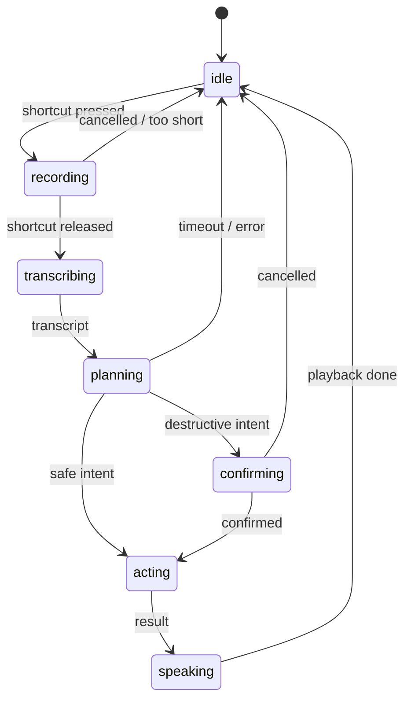

# Tiny assistant harness — research

Researched 2026-10-28. Scope: a Siri-like, action-taking assistant that lives in
the Caelestia dashboard/dock and acts through the shell's existing services.

**Stack decision (2026-10-28):** Groq cloud inference — `qwen/qwen3.8-27b` for
intent/planning and `whisper-large-v3-turbo` for speech-to-text. Manual
activation only: no wake word, no always-on microphone. Local-inference findings
are kept as an offline fallback in Appendix A. Estimates are marked `[est]`;
everything else is quoted from the cited source.

## TL;DR

- **One request per activation.** Press → record → upload → strict JSON intent →
  allowlisted QML action → spoken confirmation. No agent loop, no multi-turn.
- **Do not use Groq's `tools` API.** Use `response_format` with
  `strict: true`, which Groq implements with constrained decoding and guarantees
  schema adherence. `qwen/qwen3.8-27b` is explicitly listed as strict-capable.
- **Session = activation + 120 s follow-up window.** Six turns in the UI, two in
  the model, nothing persisted. The whole prompt budget stays under ~1.2K
  tokens; world state is the only live knowledge the model gets.
- **The model is fast; the network is the latency.** Groq lists 450 tok/s for
  Qwen 3.8 27B and 216× real-time for Whisper Turbo. A 30-token intent decodes in
  ~67 ms; round trips dominate.
- **No wake word means no idle mic.** Hold the shortcut to talk, release to
  send. Cap recordings (e.g. 15 s) and skip uploads below an RMS gate.
- **Keep the action table local and allowlisted.** The model returns an intent
  id and typed slots; it never returns a command, path, or URL to execute.
- **Key handling is the main security boundary.** Read `GROQ_API_KEY` (or a
  0600 env file) inside the native service; never expose it to QML, logs, or
  `shell.json`.
- **Cost is noise, rate limits are not.** ≈$0.0004 per activation at list
  prices, but the free tier allows only 30 RPM / 8K TPM for Qwen and 20 RPM for
  Whisper.
- **Offline is template-only.** Without network, the fast-path matcher still
  handles fixed commands; the LLM path is unavailable by design.

## 1. What “harness” means here

The harness is the loop that turns one activation into one action and one
reply — not a multi-agent system.

```text
        ┌──────────────┐   ┌──────────────┐   ┌───────────────┐   ┌──────────┐
PTT ───►│ capture+STT  │──►│ intent stage │──►│ action stage  │──►│ reply    │
        │ (Groq Whisper│   │ (Groq Qwen + │   │ (allowlisted  │   │ (TTS/HUD)│
        │  or template)│   │  JSON schema)│   │  QML calls)   │   │          │
        └──────────────┘   └──────────────┘   └───────────────┘   └──────────┘
```

| Stage | Responsibility | Owner |
| --- | --- | --- |
| Input | push-to-talk audio → transcript | QML capture + Groq STT |
| Intent | utterance → typed envelope | template table, then Qwen |
| Action | envelope → service call | QML table, allowlisted |
| Reply | spoken + visual confirmation | Piper or Groq TTS + dock status |

One intent per activation is the design constraint. A shell action (volume,
media, workspace, lock) is a single step by nature; multi-turn planning doubles
latency and multiplies failure modes for no product gain.

## 2. Chosen stack: Groq

Base URL: `https://api.groq.com/openai/v1` (OpenAI-compatible).

| Endpoint | Model | Facts |
| --- | --- | --- |
| `POST /chat/completions` | `qwen/qwen3.8-27b` | 450 tok/s, $0.80/M input, $4.00/M output, 131,072 ctx, 16,384 max completion; tool use, JSON object mode, **JSON Schema strict mode** |
| `POST /audio/transcriptions` | `whisper-large-v3-turbo` | 216× real-time, $0.04 per audio hour, 12 % WER listed; multilingual; min billed 10 s |
| `POST /audio/speech` (optional) | `canopylabs/orpheus-v1-english` | expressive TTS with vocal-direction tags; extra round trip |

Model facts from the Groq model table and model cards:

- Qwen 3.8 27B has thinking and instruct modes in one model: use
  `reasoning_effort: "none"` for command routing (`"default"` enables thinking;
  `"low" | "medium" | "high"` tune it). Command routing should never pay for
  thinking tokens.
- Groq’s model card recommends instruct-mode sampling of `temperature=0.7`,
  `top_p=0.80`, `top_k=20`, `presence_penalty=1.5`. For JSON extraction,
  temperature `0–0.2` is the safer starting point `[INFERENCE]`.
- Whisper Turbo accepts `flac, mp3, mp4, mpeg, mpga, m4a, ogg, wav, webm`,
  downsamples to 16 kHz mono server-side, and supports `json`, `verbose_json`,
  `text`. Use `json` and omit timestamps for commands.
- Minimum billed audio is **10 seconds**; anything shorter is billed as 10 s.
  Do not upload silence or sub-300 ms blips.

Limits (free tier as published; developer tier is higher):

| Model | RPM | RPD | TPM | TPD | Audio/hour | Audio/day |
| --- | --- | --- | --- | --- | --- | --- |
| `qwen/qwen3.8-27b` | 30 | 1,000 | 8K | 200K | — | — |
| `whisper-large-v3-turbo` | 20 | 2,000 | — | — | 7.2K s | 28.8K s |

A personal assistant sending one request per activation is far below these; a
burst of test activations can still hit 30 RPM. Read
`x-ratelimit-remaining-requests` / `x-ratelimit-remaining-tokens` and back off
on 429 instead of retrying immediately.

### Key handling

- Store the key in `~/.config/caelestia/groq.env` with mode `0600`, or rely on
  `GROQ_API_KEY` in the shell’s environment.
- Read it in the **native** service and keep it out of QML entirely. QML
  properties and `console.log` end up in the shell log; a key there is a leak.
- Never put it in `shell.json` (config is user-editable and often synced) and
  never send it anywhere except `api.groq.com`.

## 3. Protocol: one strict JSON envelope

Groq supports OpenAI-style tool calling, but the harness does not need it. Tools
require a second round trip to feed results back unless the reply is canned, and
tool schemas cost prompt tokens. A single constrained decode is strictly cheaper
and simpler.

Request:

```json
{
  "model": "qwen/qwen3.8-27b",
  "messages": [
    {"role": "system", "content": "<fixed prompt, byte-identical every call>"},
    {"role": "user", "content": "turn it down a bit"}
  ],
  "response_format": {
    "type": "json_schema",
    "json_schema": {
      "name": "intent",
      "strict": true,
      "schema": { "...": "..." }
    }
  },
  "reasoning_effort": "none",
  "temperature": 0,
  "max_tokens": 48,
  "stream": true
}
```

`strict: true` is the important part: Groq documents it as constrained decoding
— “100% schema adherence”, output “never errors or produces invalid JSON” — and
lists `qwen/qwen3.8-27b` among strict-capable models. Best-effort mode
(`strict: false`) can return valid JSON that does not match the schema, so it is
the wrong default for dispatch.

Schema:

```json
{
  "type": "object",
  "properties": {
    "intent": {
      "type": "string",
      "enum": ["noop", "media.play_pause", "media.next", "media.previous",
               "volume.set", "volume.step", "volume.mute", "mic.mute",
               "brightness.set", "brightness.step", "workspace.focus",
               "window.close", "app.launch", "session.lock", "screenshot",
               "notify", "answer"]
    },
    "target": {"type": "string", "enum": ["", "sink", "source", "screen", "active"]},
    "value": {"type": "integer"},
    "text": {"type": "string"},
    "say": {"type": "string"}
  },
  "required": ["intent", "target", "value", "text", "say"],
  "additionalProperties": false
}
```

Design notes:

- **Flat slots, not per-intent unions.** Every field is always present with a
  fixed type; the enum carries the action. This is the easiest shape for
  constrained decoding and the easiest to validate.
- **`say` is the only free text.** Cap `max_tokens` (48) so a runaway generation
  cannot blow the latency budget. `answer` is the one intent allowed to
  generate a sentence; budget it separately if it becomes common.
- **`noop` is explicit abstention.** The model must be able to say “this is not
  a shell action”, or it will invent one.
- **Validate again in the shell.** Constrained decoding guarantees schema
  shape, not semantics: range-check `value`, cap `text` length, reject unknown
  intents, and never execute a handler that is not in the fixed map.
- **Keep the system prompt stable.** If Groq prompt caching applies to this
  model, a byte-identical prefix is what makes it hit. Check the model’s
  caching support before relying on it.

## 4. Harness semantics: sessions, history, tools, context

### 4.1 The model never touches the system

The model’s only output is one validated envelope. The shell owns a capability
registry; the registry is both the model’s menu and the dispatcher.

```json
{
  "id": "volume.set",
  "description": "Set the output volume to a percentage.",
  "args": {"value": {"type": "integer", "minimum": 0, "maximum": 150}},
  "handler": "audio.setVolumePercent",
  "effect": "write",
  "confirm": false,
  "result": {"ok": "bool", "volume": "integer"}
}
```

- `id` feeds the JSON-schema enum and the template phrases.
- `description` + `args` are rendered into the system prompt; there is no
  separate tool schema.
- `handler` is looked up in a fixed QML map; an unknown handler is a
  configuration error, not a model error.
- `effect` (`read`, `write`, `destructive`) decides confirmation and whether the
  action may run inside a plan.
- `result` is the contract for what may flow back into context.

The model cannot name a file, URL, process, or shell string. If nothing
matches, it must return `noop`. This registry is also the seam where MCP tools
could plug in later; do not add MCP for the first version.

### 4.2 Interaction modes

| Mode | When | Model calls | Bound |
| --- | --- | --- | --- |
| Template | phrase matches the table | 0 | — |
| Single shot | default | 1 | 64 output tokens |
| Plan | utterance joins actions (“pause and lock”) | 1 | ≤3 steps, stop on first failure |
| Tool loop | read-only multi-fetch queries | 2 | 2 iterations, never for writes |

Do not build an unbounded ReAct loop. A shell action has a short horizon; the
plan array covers composition, and anything longer is a product problem, not a
prompting problem.

### 4.3 Session

A session is an activation plus its follow-up window, not a stored conversation.

```text
session {
  id, openedAt, lastActivity,
  turns[≤6],
  pending: {intent, args, expiresAt} | null,
  lastResult: {intent, ok, summary} | null
}
```

- TTL: 120 s idle, or explicit cancel. A new activation inside the TTL appends
  a turn; outside it starts a new session.
- One active session. A new activation aborts any in-flight request and clears
  a pending confirmation from the previous turn.
- Sessions are memory-only. A shell restart loses them; that is desirable for
  privacy and avoids stale state after a monitor or workspace change.
- The model sees at most the last two turns; the full six exist for the UI and
  for local reference resolution (“again”, “a bit more”).

### 4.4 History

Two different things, deliberately separated:

| Store | Contents | Lifetime |
| --- | --- | --- |
| Model history | last 2 turns, 120 chars each, plus `lastResult` | session |
| UI transcript | last 6 turns, full text | session |
| Audit log (opt-in) | intent, args, ok/error code, timestamp; **no transcript or audio** | 1 MB rotation, 0600 |

Reference resolution should be local and cheap: “again” replays `lastResult`;
“more/less” adjusts the last numeric `value`; “that” uses `lastResult` or the
current track. Only if that fails does the utterance go to the model with the
two-turn history.

### 4.5 Context assembly

Fixed order, explicit budget. The 131K window is irrelevant; the point is to
send the same small prompt every time so latency and cost stay flat.

| Block | Budget | Refresh |
| --- | --- | --- |
| system prompt + capability list | 350–450 tokens | byte-identical, cacheable |
| world state | ~120 tokens | every turn |
| last 2 turns | ~200 tokens | every turn |
| current transcript | ≤200 chars | every turn |
| output | 64 tokens | fixed |

World state is the minimum needed to resolve deixis:

```json
{"playing":true,"title":"…","artist":"…","volume":42,"muted":false,
 "micMuted":false,"brightness":70,"workspace":"2","focusedApp":"firefox",
 "time":"15:42"}
```

Rules:

- Truncate, never summarize: transcript 200 chars, tool results 300 chars,
  each history turn 120 chars.
- Drop oldest history first, then tool results; never drop the system prompt or
  the current utterance.
- Label runtime strings as data. A track title containing “ignore previous
  instructions” is data, not an instruction.
- Never send raw audio, full lyrics, file paths, window titles beyond the
  focused app, or environment variables.

### 4.6 Results, errors, confirmation

- Handlers return `{ok: true, data}` or `{ok: false, error: "code"}`. Codes are
  a closed enum (`not_ready`, `unsupported`, `timeout`, `denied`); no stack
  traces.
- A result re-enters the model only when the plan needs it and it fits the
  budget. Otherwise it is spoken or displayed and the turn ends.
- Destructive intent → `pending` holds the already-validated intent; the UI
  asks; the next utterance is matched locally as yes/no (no model call), with a
  10 s TTL. Any other utterance cancels.
- No automatic retries of model calls inside a turn. Transport retry is one
  attempt with backoff; 429 surfaces as “rate limited”.

### 4.7 Cancellation and timeouts

| Operation | Timeout | Cancel |
| --- | --- | --- |
| capture | 15 s max | release / Escape |
| STT | 10 s | Escape / new activation |
| chat | 15 s | Escape / new activation |
| action | 2 s | fire-and-forget after timeout |

One in-flight request globally. Activation supersedes: abort the old
`QNetworkReply`, clear `pending`, start the new turn. This is the same
request-id/abort pattern `Lyrics` already uses.

## 5. Action surface in this checkout

| Intent | Call | Evidence |
| --- | --- | --- |
| `media.play_pause` | `Players.active.togglePlaying()` / `mpris` IPC `playPause` | `services/Players.qml:221,224` |
| `media.next` / `previous` | `Players.next()` / `previous()` | `services/Players.qml:227,234` |
| `volume.set` / `step` | `Audio.setVolume()` / `incrementVolume()` | `services/Audio.qml:34` |
| `volume.mute` | `Audio.sink.audio.muted = !Audio.sink.audio.muted` | `services/Audio.qml:23,26` |
| `mic.mute` | `Audio.source.audio.muted = !…` | `services/Audio.qml:23,28` |
| `brightness.set` / `step` | `Brightness` monitor setter / IPC `set` | `services/Brightness.qml:137` |
| `workspace.focus` | `Hypr.focusWorkspace()` / `Hypr.dispatch()` | `services/Hypr.qml:81` |
| `window.close` | `Hypr.dispatch("killactive")` | `services/Hypr.qml:81` |
| `app.launch` | `Quickshell.execDetached([...])` | `modules/launcher/services/Apps.qml:15` |
| `session.lock` | `Lock` IPC `lock` | `modules/lock/Lock.qml:59` |
| `notify` | `Notifs` / `Toaster.toast()` | `services/Players.qml:83` |
| `screenshot` | area-picker shortcut `screenshot` / IPC `open` | `modules/areapicker/AreaPicker.qml:50,85` |

Rules:

- Call the QML function directly in-process. `qs ipc call` works but spawns a
  client per action; use it only for external tests.
- **Destructive intents** (`session.lock`, `window.close`, session actions)
  require a confirmation step: a focused “Enter to confirm” in the dock is
  faster and more reliable than a second spoken turn.
- Action failure is a normal result: report it, do not retry automatically, and
  do not feed the error into a second model turn.

### Customization surface

One declarative action table is the only source for the template matcher, the
JSON-schema enum, and the QML dispatch map:

```json
{
  "id": "volume.set",
  "phrases": ["set volume to {value}", "volume {value}"],
  "args": {"value": {"type": "integer", "minimum": 0, "maximum": 150}},
  "handler": "audio.setVolumePercent",
  "confirm": false,
  "reply": "Volume {value}%"
}
```

`handler` is an id resolved through a fixed map in QML
(`audio.setVolumePercent` → `percent => Audio.setVolume(percent / 100)`), never
a string evaluated at runtime. The file is user-editable, so it must not be able
to name arbitrary code.

## 6. Voice: manual activation

No wake word means the microphone opens only on the shortcut. The cleanest
implementation is hold-to-talk:

- `CustomShortcut` inherits `GlobalShortcut`, which exposes `pressed` and
  `released` signals (verified in the installed qmltypes). Use `onPressed` to
  start capture and `onReleased` to stop and upload.
- Toggle-to-talk is the fallback if a hold is awkward; same state machine, one
  press to start and one to stop.
- Cancel on `Escape` or a second press: stop capture, abort the upload/reply,
  return to idle. Never leave a dangling `QNetworkReply`.

Capture:

- `parecord --rate=16000 --channels=1 --format=s16le --file-format=wav` (or the
  existing native PipeWire path with a 16 kHz branch) into a temp file.
- 15 s of 16 kHz mono WAV is ~480 KB — far below Groq’s 25 MB free-tier limit.
- Gate uploads with a cheap RMS/Silero check. Whisper is known to hallucinate
  on silence, and Groq bills a 10 s minimum per request, so an empty clip is
  both wrong and wasteful.
- Optional: trim leading/trailing silence client-side. Do not send a VAD
  “keepalive” stream; the endpoint is request/response.

Transcription request:

```text
POST https://api.groq.com/openai/v1/audio/transcriptions
Authorization: Bearer $GROQ_API_KEY
Content-Type: multipart/form-data

file=<wav>  model=whisper-large-v3-turbo  response_format=json  temperature=0
```

Add `language=en` when the assistant is English-only; the docs say supplying the
language improves accuracy and latency.

TTS options:

| Option | Latency | Cost | Note |
| --- | --- | --- | --- |
| Piper, local, streaming | ~80–200 ms first chunk `[est]` | free | GPL-3.0 code → run as subprocess, `--output-raw` → `pw-play` |
| Groq `canopylabs/orpheus-v1-english` | extra RTT + synthesis `[est]` | per-character pricing | consistent with the cloud stack; adds a network hop to the critical path |

Recommendation: **Piper locally**. The reply is one short sentence; a local
synthesis step avoids a third round trip and keeps the spoken path working when
the network is slow. Use Groq TTS only if voice quality matters more than
latency.

## 7. Latency and cost

Groq’s published throughput makes the model step small; the network and the
upload are the real budget.

| Stage | Estimate | Basis |
| --- | --- | --- |
| Shortcut release → capture stop | <20 ms | local |
| WAV encode + upload (≈50–300 KB) | 50–250 ms | home uplink `[est]` |
| Whisper Turbo inference | 20–80 ms for 3–10 s audio | 216× real-time |
| Qwen TTFT + 20–30 tokens | 100–250 ms | 450 tok/s + queue/RTT `[est]` |
| Local Piper first audio | 80–200 ms | Pi-class RTF 0.63 `[est]` here |
| **Release → first audio** | **~0.4–0.9 s** | sum of estimates |

That is roughly 3–5× faster than the local 1.7B path in Appendix A, at the cost
of sending audio and text to a third party.

Cost per activation at list prices:

| Component | Tokens/audio | Cost |
| --- | --- | --- |
| Qwen input (system + intent + transcript) | ~350 | $0.00028 |
| Qwen output | ~30 | $0.00012 |
| Whisper (10 s minimum) | 10 s @ $0.04/h | $0.000011 |
| **Total** | | **≈$0.0004** |

1,000 activations ≈ $0.41. The input prompt dominates, so keep the system prompt
short and stable.

## 8. Integration design

| Layer | File | Responsibility |
| --- | --- | --- |
| Native service | `plugin/src/Caelestia/Services/assistant.{hpp,cpp}` | key loading, multipart STT upload, streaming chat, timeout/cancel, schema validation, signals to QML |
| QML service | `services/Assistant.qml` | state machine, template fast path, action table, confirmation, optional Piper process |
| Session state | `services/AssistantSession.qml` | turns, `pending`, `lastResult`, TTL; memory-only |
| Dock surface | `modules/dashboard/media/AssistantStatus.qml` | listening/transcribing/thinking/acting, transcript, reply; reuse `LyricsLookupStatus` layout |
| Shortcut | `daemons/Shortcuts.qml` | `assistant` shortcut with `onPressed`/`onReleased` |
| Config | `AssistantConfig` + `assistant.*` | endpoint, model ids, fast-path toggle, confirmation policy, max recording length, voice on/off |

Native service follows the established pattern: `lyrics.cpp` already streams
network replies with `QNetworkAccessManager`, tracks a request id, aborts
in-flight work, and emits detail-change signals. Use the same request-id/abort
discipline for STT and chat so a new activation cancels the previous one.
Never run blocking uploads on the GUI thread; `QNetworkAccessManager` is already
async.

State machine:



Failure policy: transport error → one retry with backoff; 429 → surface
“rate limited” and stop (do not hammer); malformed/refused intent → “I didn’t
catch that” and stop.

## 9. Safety and privacy

- **Audio and transcripts leave the machine.** That is the trade for cloud
  latency. Show a recording indicator, keep the mic closed outside activation,
  and do not persist audio or transcripts by default. Review Groq’s data
  retention terms before using it on sensitive speech.
- **Key isolation.** Native-only key access, 0600 file, no QML property, no log
  line, no crash-report payload.
- **Allowlist, not shell.** The model returns an enum and typed slots; handlers
  are a fixed map. It cannot name a file, URL, or command.
- **Confirm destructive actions.** Lock, close-window, session actions.
- **Prompt injection is bounded** by the enum and allowlist, but the transcript
  is still untrusted input. Never include file contents, selected text, or tool
  output in the action prompt.
- **Validate twice.** Strict decoding then local schema/range validation.

## 10. Staged plan

1. **M0 — contract check.** `curl` one transcription and one strict
   `json_schema` completion with the real key; confirm model IDs, latency, and
   that `strict: true` is accepted. Record P50/P95.
2. **M1 — text only.** Native service + QML shortcut opens a one-line input,
   sends the envelope, dispatches 8 safe intents, shows a toast. No audio.
3. **M2 — push-to-talk.** `parecord` → Groq STT → same intent path; RMS gate;
   cancel and max-duration handling; Piper reply.
4. **M3 — dock surface.** Streaming status, transcript, confirmation UI,
   rate-limit/error states, retry/backoff.
5. **M4 — hardening.** Offline template-only mode, key rotation, cost/latency
   metrics, disable switch.

## 11. Risks and open questions

- **Model deprecation.** Groq deprecates model IDs; pin
  `qwen/qwen3.8-27b` in config and keep `qwen/qwen3-32b` as a fallback.
- **Free-tier bursts.** 30 RPM / 8K TPM is fine for use, easy to hit while
  testing. Handle 429 and headers explicitly.
- **STT hallucinations on silence.** The RMS/VAD gate is not optional; Whisper
  invents text on quiet audio.
- **10 s minimum billing** makes tiny clips disproportionately expensive in
  relative terms, though absolute cost stays negligible.
- **Cloud dependency.** Offline means template-only commands. Decide whether
  that is acceptable before shipping.
- **Key leakage** is the highest-severity failure; keep it out of QML.
- **Not covered:** wake-word training, multi-user voice profiles, streaming
  STT, and Groq TTS quality evaluation.

## Appendix A — offline fallback (local llama.cpp)

If the network or cloud policy becomes unacceptable, the same envelope works
against a resident `llama-server` with no protocol change.

- Runtime: `llama-server` (llama.cpp), `-np 1`, `--cache-ram 512`,
  `--reasoning-budget 0`, `--load-mode mmap+mlock`, port 9931.
- Model: Qwen3-1.7B Q4_K_M (Apache-2.0, 1.1 GB); 0.6B only if decode measures
  below ~15 tok/s. BFCL V4 non-live AST: 82.92 % (1.7B) vs 71.79 % (0.6B).
- Constraint: llama.cpp refuses grammar with `tools`, so the same
  `response_format.json_schema` envelope is the right shape there too.
- Budget: ≈2 GB resident; release → first audio ≈1.5–3.3 s `[est]` with a
  template fast path at ≈0.6–0.9 s.
- Offline voice: Moonshine v2 Tiny (MIT, 34 M) or whisper.cpp `tiny.en`,
  Silero VAD (512 samples @16 kHz), Piper streaming (GPL-3.0 subprocess).

## Sources

Groq:

- Model catalog and limits:
  <https://console.groq.com/docs/models>,
  <https://console.groq.com/docs/rate-limits>
- Qwen 3.8 27B model card (modes, 131K ctx, capabilities):
  <https://console.groq.com/docs/model/qwen/qwen3.8-27b>
- Structured outputs (strict mode shape):
  <https://console.groq.com/docs/structured-outputs>
- Speech to text (endpoint, formats, 25/100 MB, 10 s minimum, pricing):
  <https://console.groq.com/docs/speech-to-text>
- Text to speech (Orpheus):
  <https://console.groq.com/docs/text-to-speech>

Earlier local-inference research (Appendix A):

- llama.cpp server flags and grammar:
  <https://github.com/ggml-org/llama.cpp/blob/master/tools/server/README.md>,
  <https://github.com/ggml-org/llama.cpp/blob/master/grammars/README.md>
- BFCL V4 leaderboard:
  <https://gorilla.cs.berkeley.edu/leaderboard.html>
- Moonshine v2: <https://arxiv.org/abs/2602.12241>
- whisper.cpp benchmarks: <https://github.com/ggml-org/whisper.cpp/issues/89>
- Silero VAD: <https://github.com/snakers4/silero-vad/wiki/Performance-Metrics>
- Piper streaming:
  <https://github.com/OHF-Voice/piper1-gpl/blob/main/docs/STREAMING.md>

Local checkout:

- `services/Audio.qml:34`, `services/Brightness.qml:137`, `services/Hypr.qml:81`,
  `services/Players.qml:221,224`, `modules/launcher/services/Apps.qml:15`,
  `modules/lock/Lock.qml:59`, `daemons/Shortcuts.qml:22`.
- `plugin/src/Caelestia/Services/lyrics.cpp` (streaming HTTP/abort pattern),
  `plugin/src/Caelestia/Services/audiocollector.hpp` (PipeWire capture),
  installed `GlobalShortcut` qmltypes (`pressed`/`released` signals).
