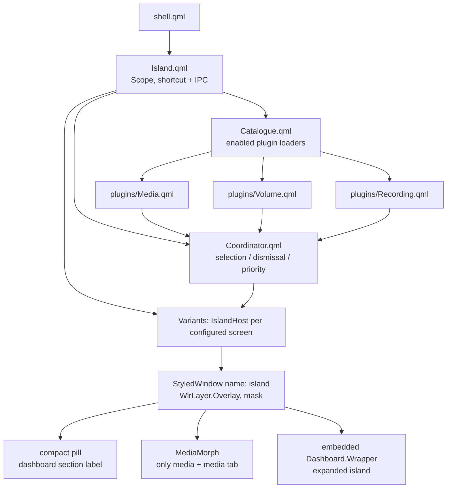

# Dynamic Island — research

Researched 2026-10-26. Scope: the UI concept, prior art, and the two
unimplemented Dynamic Island designs in this fork. Sources are the branch tips
and primary docs, not secondary summaries.

## TL;DR

- Current `fork` HEAD (`d18993b9`, 2026-10-24) contains **no** island code.
- Two **local-only** branches implement two different products, both branched
  from `d140792f` (2026-09-14, `v2.4.0-56-gd140792f`), neither merged nor pushed:
  - `dynamic-island-wip`: activity engine + overlay island + dashboard moved
    into the island. 4 commits, 34 files, +2016/−231.
  - `feat/dynamic-island`: the dashboard itself morphed into a compact/expanded
    pill. 1 commit, 13 files, +518/−116.
- The branches are mutually exclusive: the feature branch has no
  `modules/island/`; the WIP branch has no `modules/DashboardIsland.qml`.
- `feat/dynamic-island` merges cleanly into current HEAD; `dynamic-island-wip`
  conflicts in 5 files (dashboard content, drawer interactions, config
  attached header, and the monotonic clock `.hpp`/`.cpp` pair).
- Upstream `caelestia-dots/shell` has no island implementation and no
  island-specific PR/issue as of upstream `main` `2e1c51fa`.

## 1. What “Dynamic Island” means

Apple introduced the term with the iPhone 14 Pro (announced 2022-09-07):

> a design that blends the line between hardware and software, adapting in real
> time to show important alerts, notifications, and activities … fluidly
> expanding into different shapes … Ongoing background activities like Maps,
> Music, or a timer remain visible and interactive.
> — [Apple Newsroom, 2022-09-07](https://www.apple.com/newsroom/2022/09/apple-debuts-iphone-14-pro-and-iphone-14-pro-max/)

Interaction contract from the current iPhone guide:

- touch and hold to expand an activity;
- swipe the expanded activity up to collapse it;
- tap to switch between activities;
- supported models can show multiple activities simultaneously and swipe
  across them.
  — [Apple Support, “View Live Activities in the Dynamic Island”](https://support.apple.com/guide/iphone/view-live-activities-in-the-dynamic-island-iph28f50d10d/ios)

For a desktop shell the recurring interpretation is therefore not “a top bar”
but a **stateful, top-centre overlay** that:

1. is a small pill at rest;
2. morphs between compact and expanded geometry;
3. presents ongoing activities (media, recording) and transient events
   (volume, notifications, timers);
4. arbitrates between simultaneous activities;
5. collapses on click-outside/Escape and yields focus only while expanded.

## 2. Prior art

| Project | What it establishes | Compatibility |
| --- | --- | --- |
| [Caelestia Island Suite](https://github.com/yotadaa/caelestia-island-suite) (`caelestia/custom/notch/`) | Most complete reference: per-output layer-shell islands, explicit `collapsed / peek / expanded / closing / suspended` state machine, priority event router, detached live-activity bubbles, OSD ownership (`island` / `classic` / `off`), theme/shape integration, lock/fullscreen suspension, installs as an overlay without editing packaged Caelestia | Built against Caelestia 2.3.0 / Quickshell 0.3.x |
| [aizen-113/Dynamic-hypr-island](https://github.com/aizen-113/Dynamic-hypr-island) | Smaller Caelestia-specific island: CPU/RAM, volume/brightness sliders, MPRIS, morphing, click-away collapse | Caelestia + Hyprland |
| [lunanoir21/quickshell-dynamic-island](https://github.com/lunanoir21/quickshell-dynamic-island) | Standalone Quickshell island: MPRIS + cava spectrum, timers/alarms, clock, mic/camera privacy indicators | Generic Hyprland |
| [k4ditano/k4](https://github.com/k4ditano/k4), [gaelzarco/qsisland](https://github.com/gaelzarco/qsisland), [St0rmosu/dynamic-island-hyprland](https://github.com/St0rmosu/dynamic-island-hyprland), [enhaoswen/Tide-island](https://github.com/enhaoswen/Tide-island) | Confirms the common form: top-edge capsule, compact/expanded modes, media/control-centre routes, plugin APIs | Generic Hyprland/niri |

The Island Suite’s [FEATURE.md](https://github.com/yotadaa/caelestia-island-suite/blob/main/FEATURE.md)
is the useful acceptance checklist: active-monitor routing, per-monitor
islands, startup suppression, coalescing, OSD ownership, focus only while
expanded, lock/fullscreen suspension, theme tokens, and live-shell tests.

Upstream status was checked directly:

- `git log upstream/main --grep=island -i` → no commits.
- `git ls-tree -r --name-only upstream/main | grep -i island` → no files.
- GitHub issue search `repo:caelestia-dots/shell island` → 1 unrelated result
  (#959, “Caelestia website”).
- Recent upstream PR list (#2218… #2029) contains no island change.

## 3. Repository state

Both branches start from the same commit:

- base: `d140792f` — `feat: add clipboard module with shortcut and IPC toggle`,
  2026-09-14.
- current fork HEAD: `d18993b9` — `update (#4)`, 2026-10-24, a large sync of
  upstream #2014…#2203.

Neither island branch is an ancestor of HEAD; neither exists on `origin`
(`git branch -r --contains` returns nothing, and there are no remote island
refs). They are local experiments only.

```text
d140792f ── 8756d110 ── becbdeff ── 4679fa50 ── 75c67024   dynamic-island-wip
    │
    └──────── eee979ce                                     feat/dynamic-island

d140792f ── eccf43a9 ── d18993b9                           fork (current)
```

Both branches delete the dashboard from the existing drawer layer:

- remove `Dashboard.Wrapper` from `modules/drawers/Panels.qml`;
- remove the dashboard region/shadow/background from
  `modules/drawers/ContentWindow.qml`, `Regions.qml`, `Interactions.qml`;
- reuse `screenState.dashboard` as the island’s expanded state.

That makes the island and the dashboard one surface, not two competing panels —
but it also removes the existing hover/drag behaviour of the dashboard.

## 4. Design A — `dynamic-island-wip`

Tip `75c67024`; 4 commits; 34 files; +2016/−231.

### Architecture



- Entry point: `modules/island/Island.qml` adds a `CustomShortcut`
  (`GlobalConfig.island.shortcut`, default `islandFocus`) and an `island` IPC
  target with `toggleFocus`, `expand`, `collapse`
  (`modules/island/Island.qml:30-50`).
- Screens: if `island.screens` is empty only the **first** screen gets an
  island; otherwise screens are filtered by name
  (`modules/island/Island.qml:15-20`). `toggleFocus()` acts on the first host
  only (`:22-26`); IPC `expand`/`collapse` affect all hosts (`:41-49`).
- Host: one `StyledWindow` named `island` (namespace `caelestia-island`) on
  `WlrLayer.Overlay`, with input mask limited to the pill while collapsed and
  `null` while expanded (`modules/island/IslandHost.qml:98-126`). Expanded
  state is `screenState.dashboard` (`:28`).
- Geometry: configurable `topGap` and `maxWidth`; pill width is derived from
  either the media morph view or a dashboard-section summary; expanded size is
  the embedded dashboard scaled to 0.82 plus a section-dot navigator
  (`IslandHost.qml:153-190`, `:328-337`).
- Existing dashboard is embedded via the new `embedded` switch on
  `Dashboard.Wrapper` (`modules/dashboard/Wrapper.qml:16, 33-38`).
- Dashboard sections were moved to a shared `Dashboard.Sections` catalogue
  (`modules/dashboard/Sections.qml`), and `Content.qml` was rewritten to load
  one section at a time.
- Typed config added under `GlobalConfig.island`: `enabled`, `screens`,
  `topGap`, `maxWidth`, `idleMode`, `showOverFullscreen`, `shortcut`, and
  per-plugin `media` / `volume` (`duration`) / `recording` toggles
  (`plugin/src/Caelestia/Config/islandconfig.hpp`).
- `CUtils.monotonicMs` was added as a `CONSTANT` `qreal` property backed by
  `QElapsedTimer` (`plugin/src/Caelestia/cutils.{hpp,cpp}`), and
  `IslandClock.qml` polls it at 100 ms while a transient activity exists.
- A behavioural test, `tests/tst_island.qml` (173 lines), covers 10
  coordinator scenarios: stable selection, transient interruption, coalescing,
  restoration, interaction hold, expiry during interaction, dismissal without
  stopping the activity, third-plugin extensibility, action dispatch, plugin
  removal.

### What actually reaches the screen

Only two presentations are wired in the host:

1. **Compact:** a dashboard-section summary (`icon + label`) from
   `sectionCompact` (`IslandHost.qml:243, 343-369`), or
2. **MediaMorph:** only when the current dashboard section is `media` **and**
   the coordinator foreground is the media plugin
   (`IslandHost.qml:31-32, 247-266`).

`ActivityPlugin.compactView`, `expandedView`, and `companionView` are never
read by the host (`ActivityPlugin.qml:7-10`; `IslandHost.qml` only accesses
`plugin.morphView`). As a result:

- `VolumeCompact`, `VolumeExpanded`, `RecordingCompact`, and
  `RecordingExpanded` are dead code on this branch.
- A volume change makes the volume activity the foreground (transient priority
  1 beats ongoing priority 0), so the media morph disappears and the pill shows
  the current dashboard section label (“Dashboard”, “Media”, …), not the
  volume.
- `Coordinator.companion`, `select()`, `dismissCurrent()`, and
  `urgentActivityIds` have no UI consumer (only the test uses `select` and
  `companion`; `urgentActivityIds` is never assigned).
- The `idleMode` config option is never read; there is no idle clock/compact
  presentation.

### Other gaps (code-reading)

| Gap | Evidence / impact |
| --- | --- |
| Volume OSD is suppressed globally, but the island does not render volume | `modules/osd/Wrapper.qml:18` disables the OSD whenever `Config.island.enabled && Config.island.plugins.volume.enabled`. The OSD suppression is global, while the island may be disabled per screen or hidden by lock/fullscreen — so volume feedback can disappear everywhere with no replacement. |
| Media morph only appears on the Media dashboard tab | `IslandHost.qml:32` requires `currentSectionData.id === "media"`. On the default Dashboard tab, active media is not shown at all. |
| Dashboard tab bar and swipe navigation were removed | `modules/dashboard/Content.qml` changes remove `Tabs` and the horizontal `Flickable`; section choice remains only through wheel over the pill/navigator (`IslandHost.qml:269-283, 412-424`). The section dots themselves have no click handler (`:412-430`). |
| Dashboard hover and drag settings became dead options | `showOnHover` and `dragThreshold` still exist in `DashboardConfig` and Nexus (`modules/nexus/pages/panels/DashboardPanel.qml:34-39, 128-136`), but the drawer hover/drag logic for the dashboard was deleted. WIP does not remove the config keys, unlike the feature branch. |
| Multi-monitor control is incomplete | Default is first screen only (`Island.qml:15-20`); shortcut toggles the first host only (`:22-26`); OSD suppression is not per-host; coordinator and catalogue are global. |
| Fullscreen detection misses special workspaces | `IslandHost.qml:25` checks only `monitor.activeWorkspace` toplevels; `ContentWindow.qml` had separate special-workspace handling. |
| No compositor layer rule for the island namespace | `services/Colours.qml:87-93` targets `caelestia-drawers`; the island window is `caelestia-island`, so existing blur/ignore-alpha rules do not apply, despite `surfaceFormat.opaque: false`. |
| Rebase required | `git merge-tree --write-tree HEAD dynamic-island-wip` conflicts in `modules/dashboard/Content.qml`, `modules/drawers/Interactions.qml`, `plugin/src/Caelestia/Config/configattached.hpp`, and `plugin/src/Caelestia/cutils.{hpp,cpp}` because HEAD includes the upstream config namespace refactor. |
| Test is not wired into the build/CI | The repo has no test target; `tests/tst_island.qml` is referenced nowhere in CMake or `.github/workflows` on the branch. It is a manual qmltestrunner artifact only. |
| Not runtime/build verified for this note | No build or live-shell run was performed. All claims above are static code/diff reading. |

## 5. Design B — `feat/dynamic-island`

Tip `eee979ce`; 1 commit; 13 files; +518/−116.

### Architecture

- New `modules/DashboardIsland.qml`: `Variants` over `Screens.screens`, one
  `StyledWindow` named `island` per monitor, `WlrLayer.Overlay`,
  `ExclusionMode.Ignore`, input mask limited to the wrapper
  (`DashboardIsland.qml:13-50`).
- `Dashboard.Wrapper` is reworked into the island surface: it keeps the
  dashboard section catalogue and defines compact views:
  `CompactDash`, `CompactMedia`, `CompactPerf`, `CompactWeather`
  (`Wrapper.qml:34-66, 174-197`).
- Compact geometry: 34 px tall pill; width from the selected compact view plus
  padding (`Wrapper.qml:79-89`). Expanded geometry: full dashboard `Content`,
  width from its implicit width (fallback 854), height from content
  (`Wrapper.qml:84-93`).
- Animated `animWidth` / `animHeight` drive both the window and the mask;
  the background radius morphs from `compactHeight / 2` to
  `Tokens.rounding.extraLarge` (`Wrapper.qml:91-122`).
- Clicking the compact pill sets `screenState.dashboard = true`; clicking
  outside is handled by `HyprlandFocusGrab` in the island window
  (`DashboardIsland.qml:62-77`); Escape collapses.
- Dashboard is removed from the drawer layer as in the WIP branch; the
  dashboard `showOnHover` and `dragThreshold` options and their Nexus rows are
  deleted (`dashboardconfig.hpp`, `DashboardPanel.qml`).

This branch has **no activity model**: no media/volume/recording coordinator,
no transient events, no activity priority. The “island” previews the selected
dashboard tab; it does not surface events outside the dashboard.

### Gaps (code-reading)

| Gap | Evidence / impact |
| --- | --- |
| Not activity-driven | Compact content is `selectedSection.compactComponent` (`Wrapper.qml:144`); no volume/recording/media event path exists. The only dynamic content is the current dashboard section. |
| Hardcoded surface, no theme integration | Background is `color: "#1C1B1F"` (`Wrapper.qml:116`); no palette surface, transparency, shadow, or blob treatment. `caelestia-island` also has no compositor layer rule. |
| Duplicated section catalogue | `Wrapper.allSections` (`Wrapper.qml:34-64`) repeats the enabled flags/order already owned by `Content.dashboardTabs` (`modules/dashboard/Content.qml:19-46`). Two sources can drift. |
| Compact pill cannot navigate sections | No wheel/click handler in `Wrapper`/`DashboardIsland`; the preview only follows `screenState.dashboardTab`, which can only be changed after expanding the full dashboard. |
| No per-monitor/configurable geometry | Every screen gets an island (`Variants model: Screens.screens`); gap is hardcoded to 8 px (`DashboardIsland.qml:42, 57`), unlike the WIP branch’s `topGap`/`maxWidth`/`screens`. |
| Fullscreen policy is all-or-nothing | `islandVisible` hides the island on any active-workspace fullscreen (`DashboardIsland.qml:26-27`); no special-workspace handling, no “show over fullscreen” option. The dashboard becomes unreachable under fullscreen except via the (blocked) shortcut path. |
| Breaking config change without migration | `dashboard.showOnHover` and `dashboard.dragThreshold` are removed from the typed config; existing `shell.json` keys become unknown. No migration/deprecation path is added. |
| No tests | The commit adds no test; the repo has no island/activity test on this branch. |
| Not runtime/build verified for this note | No build or live-shell run was performed; claims are static code/diff reading. |

`git merge-tree --write-tree HEAD feat/dynamic-island` reports no conflicts, so
this design is the cheaper one to bring onto current `fork`.

## 6. Comparison

| Dimension | `dynamic-island-wip` | `feat/dynamic-island` |
| --- | --- | --- |
| Product model | Activity-driven island that also hosts the dashboard | Dashboard that collapses into a pill |
| Entry point | `modules/island/Island.qml` | `modules/DashboardIsland.qml` |
| Compact content | Dashboard-section summary; MediaMorph when media tab + media foreground | Selected dashboard section preview |
| Transient activities | Coordinator exists (priority, coalescing, dismissal, expiry) | None |
| Shipped activity UI | Media morph only; volume/recording views unreachable | None |
| Expanded content | Embedded `Dashboard.Wrapper` + section navigator | Full dashboard `Content` |
| OSD integration | Suppresses volume OSD globally but does not render volume | None (OSD unchanged) |
| Theme/visual | Palette colours, pill + card, overlay layer, no layer rule | Hardcoded `#1C1B1F`, no layer rule |
| Multi-monitor | Opt-in by name, first screen by default | Every screen |
| Config | New typed `island.*` config + `screens`/`topGap`/`maxWidth`/`idleMode`/`showOverFullscreen` | Removes two dashboard config keys; hardcoded gap |
| Tests | 10-case coordinator test, not wired | None |
| Rebase onto HEAD | 5-file conflict | Clean |
| Diff size | 34 files, +2016/−231 | 13 files, +518/−116 |
| Existing dashboard hover/drag | Behaviour removed; config/Nexus controls left stale | Behaviour and config/Nexus controls removed |

## 7. Implications

- The two branches answer different questions. `dynamic-island-wip` is the only
  existing **activity substrate** (coordinator, plugin interface, tests), but
  its presentation layer regressed to a dashboard-section pill and never
  consumes the plugin views — so it does not behave like an island yet.
  `feat/dynamic-island` is a clean, mergeable **dashboard morph**, but it has
  no notion of events, priority, or live activities.
- Both reuse `screenState.dashboard` as the expanded state and remove the
  dashboard from `Drawers`. That is a sound way to avoid duplicate panels, but
  it means the island inherits dashboard semantics (hover/drag/highlight
  options, fullscreen policy, Nexus panel) and those need an explicit
  migration, not just deletion.
- The prior art’s hardest pieces are not geometry: event arbitration, transient
  vs ongoing lifetime, coalescing, OSD ownership, per-monitor routing,
  startup suppression, and collapse/focus policy. The WIP coordinator covers
  part of the first two; neither branch covers the rest.
- Before choosing a design, decide whether “Dynamic Island” means
  “collapsible dashboard” (feature branch) or “live activity surface” (WIP /
  Island Suite). The two are not the same feature.

## Sources

Local refs (all on this clone):

- `git show dynamic-island-wip:<path>` at `75c67024`.
  Files: `modules/island/{Island,IslandHost,Coordinator,Catalogue,IslandClock}.qml`,
  `modules/island/plugins/*`, `modules/dashboard/{Wrapper,Content,Sections}.qml`,
  `modules/{drawers/Panels,drawers/ContentWindow,drawers/Interactions,drawers/Regions}.qml`,
  `modules/osd/Wrapper.qml`, `plugin/src/Caelestia/Config/islandconfig.hpp`,
  `plugin/src/Caelestia/cutils.{hpp,cpp}`, `tests/tst_island.qml`.
- `git show feat/dynamic-island:<path>` at `eee979ce`.
  Files: `modules/DashboardIsland.qml`, `modules/dashboard/Wrapper.qml`,
  `modules/dashboard/compact/*`, `plugin/src/Caelestia/Config/dashboardconfig.hpp`,
  `modules/nexus/pages/panels/DashboardPanel.qml`, `shell.qml`.
- `git diff --shortstat d140792f..dynamic-island-wip` → `34 files changed,
  2016 insertions(+), 231 deletions(-)`.
- `git diff --shortstat d140792f..feat/dynamic-island` → `13 files changed,
  518 insertions(+), 116 deletions(-)`.
- `git merge-tree --write-tree HEAD dynamic-island-wip` → conflicts in
  `modules/dashboard/Content.qml`, `modules/drawers/Interactions.qml`,
  `plugin/src/Caelestia/Config/configattached.hpp`,
  `plugin/src/Caelestia/cutils.{hpp,cpp}`.
- `git merge-tree --write-tree HEAD feat/dynamic-island` → clean tree
  `6b0c05c3`.
- `git branch -r --contains <island-tip>` → no output (local-only).
- `git log upstream/main --grep=island -i` → no output.
- `git ls-tree -r --name-only upstream/main | grep -i island` → no output.

External:

- Apple Newsroom, “Apple debuts iPhone 14 Pro and iPhone 14 Pro Max”,
  2022-09-07 — https://www.apple.com/newsroom/2022/09/apple-debuts-iphone-14-pro-and-iphone-14-pro-max/
- Apple Support, “View Live Activities in the Dynamic Island on iPhone” —
  https://support.apple.com/guide/iphone/view-live-activities-in-the-dynamic-island-iph28f50d10d/ios
- Caelestia Island Suite README and FEATURE.md —
  https://github.com/yotadaa/caelestia-island-suite
  https://github.com/yotadaa/caelestia-island-suite/blob/main/FEATURE.md
- aizen-113/Dynamic-hypr-island —
  https://github.com/aizen-113/Dynamic-hypr-island
- Generic Quickshell island prior art —
  https://github.com/lunanoir21/quickshell-dynamic-island
  https://github.com/k4ditano/k4
  https://github.com/gaelzarco/qsisland
  https://github.com/St0rmosu/dynamic-island-hyprland
  https://github.com/enhaoswen/Tide-island
- GitHub search API, `repo:caelestia-dots/shell island` —
  https://api.github.com/search/issues?q=repo%3Acaelestia-dots%2Fshell+island
  (total_count 1, unrelated #959).
